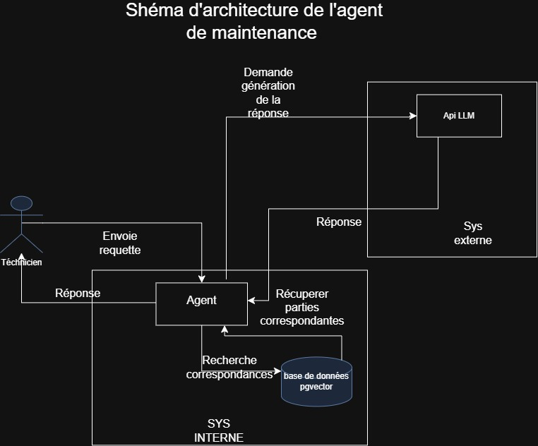

# Assistant technique intelligent (RAG + agents) — secteur Industrie

## Introduction
Le projet consiste à coder un agent technique intelligent (RAG + agent IA ) pour la maintenance industrielle, il aide les techniciens à retrouver la bonne procédure pour réparer une machine en panne en quelques secondes au lieu de 35 minutes.

## Problème
Ferro-Nord Équipements (client fictif, ETI ~1150 salariés, ~3400 machines
chez ~600 clients) a ~14 000 pages de documentation technique dispersée
(manuels, schémas, PDF scannés, Word, Excel) à travers plusieurs
générations de machines. Face à une panne, un technicien :
- perd du temps à chercher la bonne procédure ~35 min/intervention 
- interrompt un collègue senior
- risque d'appliquer la mauvaise procédure dû au grand nombre de générations

## Impact estimé 
 ~585 k€/an de temps improductif (62 techniciens x
~1h/jour perdue x ~210 jours), hors pénalités SLA.

## Objectif 
Un assistant qui répond aux questions techniques des SAV en citant la
bonne procédure, avec les bons garde-fous (pas d'invention).

## Architecture (cible)



## KPI cibles

| KPI                          | Cible v1      |
|-------------------------------|---------------|
| Temps de recherche moyen      | < 2 min (vs ~35 min) |
| Réponses correctes et sourcées| > 85 %        |
| Taux d'hallucination          | < 2 %         |
| Coût moyen / requête          | < 0,05 €      |

## Stack (prévue)

Python, PostgreSQL + pgvector, FastAPI, LangGraph, Docker, RAGAS.


## Statut

🚧 En cours de développement (v0 : fondations).

- [x] Environnement (uv, Python 3.12), structure `src/`, tests pytest
- [x] Configuration (pydantic-settings, `.env`)
- [x] Loader de documents (.txt, .md, .pdf) → `Document` typés
- [ ] Découpage en chunks
- [ ] Embeddings et recherche sémantique
- [ ] Chaîne RAG, évaluation, API, agent

## Installation

Prérequis : [uv](https://docs.astral.sh/uv/) et Python 3.12.

```bash
git clone https://github.com/kamar-bit/rag-maintenance-agent.git
cd rag-maintenance-agent
uv sync
cp .env.example .env        # puis renseigner RAG_LLM_API_KEY
```

Sous Windows PowerShell : `Copy-Item .env.example .env`.

## Configuration

Les paramètres sont lus depuis l'environnement ou un fichier `.env`
(préfixe `RAG_`). Voir `.env.example`.

| Variable | Rôle | Défaut |
|---|---|---|
| `RAG_LLM_API_KEY` | Clé d'API du LLM (obligatoire) | - |
| `RAG_LOG_LEVEL` | Niveau de logs | `INFO` |
| `RAG_CHUNK_SIZE` | Taille des chunks | `800` |
|`RAG_MAX_FILE_MB`|Taille max des fichiers (en Mo)|`50`|

## Tests

```bash
uv run pytest
```

## Structure

```
src/rag_maintenance_agent/
├── config.py        # Settings (pydantic-settings)
├── ingest/          # chargement des documents
│   ├── models.py    # Document
│   └── loader.py    # charger_document, charger_dossier
├── retrieval/       # (à venir) chunking, embeddings, recherche
└── api/             # (à venir) FastAPI
tests/
docs/                # schéma d'architecture
```
## Corpus

Le client Ferro-Nord Équipements est fictif. Pour tester le système, j'utilise
des documents techniques :

| Source | Type | Documents |
|---|---|---|
| Kaeser, *Technique d'air comprimé : notions fondamentales et conseils* ([kaeser.com](https://www.kaeser.com)) | manuel PDF (33 pages) | 1 |
| Rédigé par moi : fiche de maintenance préventive d'un convoyeur | Markdown | 1 |
| Rédigé par moi : glossaire de maintenance industrielle | texte | 1 |

Le manuel Kaeser est protégé par le droit d'auteur : il est utilisé en local
à des fins d'apprentissage et n'est pas redistribué dans ce dépôt.

**Résultat du chargement** : 3 fichiers chargés, 0 en échec.